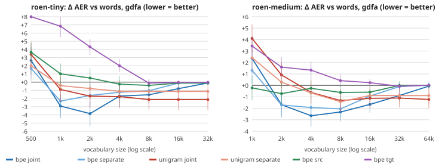
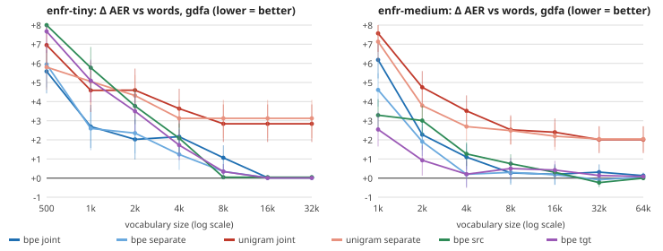

# Subword alignment: experiments and defaults (Step 13)

Measured 2026-11-19 on this machine. The question: does segmenting words into subwords before
alignment and projecting the links back to words give better word alignments than fast_align on
the words themselves? If it does, where, and with which settings? Every number below is a
word-level AER against the gold sets. Subword runs are projected back to whitespace words, so the
output has exactly the shape of a word-level run.

## Summary

* **Subwords help ro-en and do not help en-fr.** On ro-en the gain is real and sizeable:
  grow-diag-final-and (gdfa) is **−2.3 AER on medium** (32.06 → 29.74) and −1.5 on tiny with the
  chosen defaults, and the directional alignments, intersection and every grow-diag variant
  improve too. On en-fr, subwords **hurt** at small vocabularies and are, at best, neutral at
  larger ones. On en-fr large with the chosen defaults: gdfa 15.29 → 15.52 (+0.23, not
  significant), forward +0.96, reverse +1.15 (both significant).
* **Defaults chosen:** SentencePiece **BPE**, **one joint model** over both languages,
  **8000 pieces**, **no split at Unicode-script changes** (`split_by_unicode_script=false`;
  needed for this en-fr corpus, see below), both sides segmented, **project-then-symmetrise**.
  The vocabulary is a **constant, not a rule**. A pieces-per-word target picks almost the same
  size on every corpus here, and a share of the word vocabulary does not fit the optima. The
  optimum moves little with corpus size (best ro-en vocabulary 2k on tiny, 4k on medium, a 40×
  size difference). 8k is the setting that keeps most of the ro-en gain and does the least damage on
  en-fr.
* **Cost:** about 1.2× the tokens. On en-fr large the aligner takes **14.4 s instead of 13.4 s
  at 20 threads (1.08×)** and **120 s instead of 109 s at 1 thread (1.10×)**, quiet machine. Its
  peak memory is *lower*, **1.33 GB against 1.56 GB**, because the piece vocabulary gives a
  smaller translation table. Tokeniser training is 12.5 s on en-fr large (streamed, 0.86 GB). The
  Python projection of the prototype (17 s) is what Step 14 moves into Rust. See [Cost](#cost).
* **Recommendation:** go ahead with Step 14, with **subwords off by default** (`subword=None`,
  as planned) and `subword="auto"` = the defaults above. Document it as an option for
  morphologically richer languages, measured on ro-en, and not as a general improvement: on
  en-fr it costs time and gives nothing.

## Setup

* Corpora (`reference/data/corpora`): **ro-en** tiny (1,248 lines) and medium (48,689), **en-fr**
  tiny (1,447), medium (100,447) and large (1,130,551). The gold sentences (248 ro-en, 447 en-fr)
  are the last lines of each corpus and are **the same sentences in every size of a pair**.
  Tiny/medium/large therefore replicate the training conditions, but not the test set.
* Aligner: `fastalign train` with its defaults (`-d -o -v`, 5 iterations, both directions), the
  same binary that is byte-identical to fast_align (`parity.sh quick` 316/316 this step).
* Tokeniser: SentencePiece 0.2.3 through `python/fastalign/subword.py`. Settings: identity
  normalisation, byte fallback, all sentences, no shuffling, 1 thread (reproducible: the en-fr
  large BPE model is byte-identical across two trainings), per-word encoding with the `▁`
  word-start marker. Swept: model type (BPE, unigram); vocabulary size 1k–64k (500–32k on tiny);
  **joint** (one model over both sides), **separate** (one per side), **src** (only the source
  side segmented: English for en-fr, Romanian for ro-en), **tgt** (only the target side);
  pre-tokenisation default vs `ns` (no script split). Both projection orders come from the same
  alignment run.
* Tools (all under `benchmarks/subword/`):
  * `sweep.py`: the sweep (`reference/runs/subword/sweep/sweep.tsv`, 6,370 rows, committed as
    `subword/results/sweep.tsv`; the en-fr large `prepare.json`, `score.json` and `bench.tsv`
    are in `subword/results/enfr-large-*`);
  * `bootstrap.py`: paired bootstrap;
  * `report.py`: the tables and the figures below;
  * `large.py`: streaming encode and projection for en-fr large;
  * `bench_large.sh`: timing;
  * `compare_files.py`: bootstrap of two Pharaoh files.

  `run.py` (Step 12) is unchanged except for the RSS fix noted above (peak RSS is measured through `/usr/bin/time`).

### What counts as a real difference

The gold sets are small, so every difference is tested with a **paired bootstrap over gold
sentences**: 2,000 resamples, the same draw for both systems, AER recomputed from the summed
counts (|A|, |S|, |A∩S|, |A∩P|) of each draw. In the tables, `*` marks a 95 % interval that
excludes 0. Typical half-widths of the interval for a subword-vs-word difference:

| corpus | gold sentences | 95 % half-width (gdfa) |
|---|---|---|
| ro-en tiny | 248 | ≈ 1.0–1.5 |
| ro-en medium | 248 | ≈ 0.8–1.0 |
| en-fr tiny | 447 | ≈ 0.9–1.1 |
| en-fr medium | 447 | ≈ 0.6–0.7 |
| en-fr large | 447 | ≈ 0.6 |

So on ro-en medium a difference below ≈ 1 AER point is noise, on en-fr below ≈ 0.6. Between
two close settings the half-width is smaller (≈ 0.3–0.8), because the two systems share most of
their links. The sweep makes ≈ 450 such comparisons, so ≈ 20 stars are expected by chance alone.
The conclusions therefore rest on patterns that repeat across neighbouring vocabulary sizes,
systems and corpus sizes, not on single starred cells.

## A corpus artefact that decides the en-fr result: U+FFFD

The en-fr Hansards copy used here has **every accented character replaced by U+FFFD** (`�`,
bytes `EF BF BD`): 79 % of French lines in medium, 891k of 1.13M in large (`Pr�sident`,
`d�put�s`). It is valid UTF-8, not Latin-1. SentencePiece's default pre-tokenisation
(`split_by_unicode_script=true`) puts a forced split wherever the Unicode script changes, and `�`
is not Latin script. So every accented French word is cut at every accent whatever the
vocabulary (`▁Pr � sident`). Even a 64k BPE model leaves French at 1.22 pieces per word,
against 1.00 with the split off. The forced splits cost en-fr medium 0.6–1.1 AER (gdfa, BPE
joint 8k: 17.71 → 17.07 with the split off, −0.64, significant; en-fr tiny −1.30, significant).
On ro-en, an ASCII corpus, it changes nothing (+0.06, −0.24, both noise). **Defaults therefore
turn the script split off.** Number splitting (`split_by_number`) was also tried. It changes
nothing (en-fr tiny, identical results), so it stays at SentencePiece's default.

Real French text with real accents would not trigger this, since `é` is Latin script. The en-fr
results below are for this corpus as it is, with the split off.

## Sweep results (gdfa, project-then-symmetrise, no script split)

Each cell is AER (Δ against word level, `*` = significant). The last column is pieces per word
of the separate models (source / target). The joint model gives slightly more pieces per word
than separate models at the same size, because the two languages share its vocabulary.





(Error bars: 95 % bootstrap intervals. Values above +8 are drawn at +8.)

### ro-en medium (word level gdfa 32.06)

| vocab | bpe joint | bpe separate | bpe src (ro only) | bpe tgt (en only) | unigram joint | pieces/word (bpe separate) |
|---|---|---|---|---|---|---|
| 1k | 34.42 (+2.36*) | 33.37 (+1.31*) | 31.84 (−0.21) | 35.50 (+3.44*) | 36.16 (+4.10*) | 1.90 / 1.82 |
| 2k | 30.37 (−1.69*) | 30.35 (−1.71*) | 31.34 (−0.72) | 33.65 (+1.59*) | 32.97 (+0.91) | 1.59 / 1.48 |
| 4k | **29.41 (−2.64*)** | 30.13 (−1.93*) | 31.80 (−0.25) | 33.39 (+1.33*) | 31.45 (−0.61) | 1.37 / 1.26 |
| **8k** | **29.74 (−2.32*)** | 30.01 (−2.05*) | 31.44 (−0.62) | 32.47 (+0.42) | 30.73 (−1.32*) | 1.22 / 1.12 |
| 16k | 30.40 (−1.66*) | 31.13 (−0.93*) | 31.47 (−0.59*) | 32.30 (+0.24) | 30.93 (−1.12*) | 1.11 / 1.04 |
| 32k | 31.17 (−0.88*) | 31.96 (−0.10) | 32.05 (−0.01) | 31.98 (−0.08) | 30.95 (−1.11*) | 1.04 / 1.01 |
| 64k | 32.00 (−0.06) | 32.07 (+0.02) | 32.06 (+0.01) | 32.09 (+0.03) | 30.84 (−1.22*) | 1.00 / 1.00 |

### ro-en tiny (word level gdfa 42.47)

| vocab | bpe joint | bpe separate | bpe src (ro only) | bpe tgt (en only) | unigram joint | pieces/word (bpe separate) |
|---|---|---|---|---|---|---|
| 500 | 45.12 (+2.65*) | 44.15 (+1.67*) | 46.13 (+3.66*) | 51.45 (+8.97*) | 45.87 (+3.39*) | 2.56 / 2.58 |
| 1k | 39.54 (−2.93*) | 40.15 (−2.32*) | 43.49 (+1.02) | 49.31 (+6.84*) | 41.57 (−0.90) | 1.90 / 1.82 |
| 2k | **38.62 (−3.85*)** | 40.85 (−1.62*) | 42.98 (+0.50) | 46.79 (+4.31*) | 40.76 (−1.71*) | 1.56 / 1.46 |
| 4k | 40.77 (−1.71*) | 41.23 (−1.24*) | 42.23 (−0.25) | 44.49 (+2.02*) | 40.70 (−1.77*) | 1.31 / 1.21 |
| **8k** | **40.93 (−1.54*)** | 41.42 (−1.05*) | 42.07 (−0.40) | 42.36 (−0.11) | 40.34 (−2.13*) | 1.11 / 1.03 |
| 16k | 41.68 (−0.79*) | 42.35 (−0.12) | 42.37 (−0.11) | 42.45 (−0.02) | 40.34 (−2.13*) | 1.00 / 1.00 |
| 32k | 42.37 (−0.10) | 42.35 (−0.12) | 42.37 (−0.11) | 42.45 (−0.02) | 40.34 (−2.13*) | 1.00 / 1.00 |

### en-fr medium (word level gdfa 16.80)

| vocab | bpe joint | bpe separate | bpe src (en only) | bpe tgt (fr only) | unigram joint | pieces/word (bpe separate) |
|---|---|---|---|---|---|---|
| 1k | 22.98 (+6.18*) | 21.42 (+4.61*) | 20.10 (+3.29*) | 19.35 (+2.54*) | 24.37 (+7.57*) | 1.83 / 1.83 |
| 2k | 19.07 (+2.27*) | 18.71 (+1.91*) | 19.81 (+3.01*) | 17.74 (+0.93*) | 21.55 (+4.75*) | 1.47 / 1.48 |
| 4k | 17.90 (+1.10*) | 17.00 (+0.20) | 18.07 (+1.26*) | 17.01 (+0.21) | 20.32 (+3.52*) | 1.24 / 1.26 |
| **8k** | **17.07 (+0.27)** | 17.10 (+0.30) | 17.56 (+0.75*) | 17.30 (+0.50) | 19.33 (+2.53*) | 1.10 / 1.13 |
| 16k | 17.00 (+0.20) | 16.98 (+0.18) | 17.11 (+0.31) | 17.23 (+0.42) | 19.20 (+2.40*) | 1.03 / 1.05 |
| 32k | 17.12 (+0.31) | 16.72 (−0.09) | 16.57 (−0.23*) | 16.94 (+0.13) | 18.81 (+2.01*) | 1.01 / 1.01 |
| 64k | 16.93 (+0.13) | 16.86 (+0.06*) | 16.80 (+0.00) | 16.89 (+0.08*) | 18.81 (+2.01*) | 1.00 / 1.00 |

### en-fr tiny (word level gdfa 25.39)

| vocab | bpe joint | bpe separate | bpe src (en only) | bpe tgt (fr only) | unigram joint | pieces/word (bpe separate) |
|---|---|---|---|---|---|---|
| 500 | 30.97 (+5.58*) | 31.33 (+5.95*) | 34.16 (+8.77*) | 33.06 (+7.67*) | 32.34 (+6.95*) | 2.59 / 2.53 |
| 1k | 28.08 (+2.69*) | 27.98 (+2.59*) | 31.16 (+5.77*) | 30.48 (+5.09*) | 29.97 (+4.59*) | 1.80 / 1.81 |
| 2k | 27.41 (+2.02*) | 27.74 (+2.35*) | 29.15 (+3.77*) | 28.88 (+3.49*) | 29.98 (+4.60*) | 1.42 / 1.45 |
| 4k | 27.55 (+2.16*) | 26.62 (+1.23*) | 27.47 (+2.08*) | 27.11 (+1.73*) | 29.02 (+3.63*) | 1.18 / 1.21 |
| **8k** | **26.45 (+1.06*)** | 25.73 (+0.34) | 25.43 (+0.05*) | 25.73 (+0.34) | 28.22 (+2.84*) | 1.00 / 1.04 |
| 16k | 25.41 (+0.02) | 25.40 (+0.02) | 25.43 (+0.05*) | 25.39 (+0.01) | 28.22 (+2.84*) | 1.00 / 1.00 |
| 32k | 25.41 (+0.02) | 25.40 (+0.02) | 25.43 (+0.05*) | 25.39 (+0.01) | 28.22 (+2.84*) | 1.00 / 1.00 |

Unigram saturates: with `hard_vocab_limit=false` its final vocabulary stops growing (35k on
ro-en medium, ≈ 28k on en-fr medium), so its rows repeat at the largest sizes. BPE reaches word
level (1.00 pieces per word) at the top of the sweep, and its AER then equals the word-level
AER, which is the identity check of Step 12 seen from the other side.

### Directional alignments and every symmetrisation method (BPE joint 8k)

| system | ro-en medium word → subword (Δ) | en-fr medium word → subword (Δ) |
|---|---|---|
| fwd | 34.84 → 32.53 (−2.31*) | 18.19 → 18.63 (+0.44) |
| rev | 34.40 → 33.49 (−0.91*) | 17.53 → 18.87 (+1.34*) |
| intersect | 33.81 → 31.74 (−2.06*) | 12.63 → 12.70 (+0.07) |
| union | 35.23 → 33.96 (−1.27*) | 21.37 → 22.70 (+1.33*) |
| grow-diag | 31.86 → 29.65 (−2.20*) | 16.18 → 16.51 (+0.34) |
| grow-diag-final | 34.52 → 31.82 (−2.70*) | 20.24 → 20.22 (−0.02) |
| grow-diag-final-and | 32.06 → 29.74 (−2.32*) | 16.80 → 17.07 (+0.27) |

On ro-en, recall rises for every system (gdfa 66.5 → 70.1), and precision holds or rises (69.5 →
70.4). Pieces of an unseen or rare Romanian inflection share statistics with the stem, which is
what subwords are for. On en-fr, the reverse direction loses most (precision 79.7 → 77.9). In
the reverse model each French piece chooses an English word, so the pieces of one French word
can choose different English words, and projection keeps all of those links.

## The other decisions

**BPE, not unigram.** At the same vocabulary size, BPE is better or level on every corpus.
At 8k joint (paired, BPE → unigram): ro-en medium +1.00\*, en-fr medium +2.26\*, en-fr tiny
+1.77\*, ro-en tiny −0.59 (noise). Unigram's segmentation of this en-fr corpus never becomes
word level (1.23 pieces per word at saturation), and unigram training is 8–10× slower (6.6–8.4 s
against 0.6–1.2 s on medium).

**Joint, not separate.** No significant difference at 8k on three corpora (ro-en medium +0.27,
ro-en tiny +0.49, en-fr medium +0.03, for separate against joint). Separate is better only on
en-fr tiny (−0.72, interval −1.40..−0.03). Joint wins because it matches fast_align's single
shared dictionary, it is one model to train, store and apply, and on ro-en it is ahead at every
size from 4k to 32k (−0.3 to −0.8, mostly within noise).

**Both sides, not one.** Segmenting only Romanian gives −0.6 on ro-en medium (noise) against
−2.3 for both sides. Segmenting only English hurts ro-en at small sizes. On en-fr, one side
alone is no better than both. The typical use case of one morphologically richer side is
better served by segmenting both sides with a joint model: the pieces of the poorer side
(English) stay close to whole words anyway (1.20 pieces per word against 1.31 for Romanian at
8k joint on ro-en medium).

**Project, then symmetrise.** Symmetrising the piece links and projecting afterwards is worse
for every grow-diag variant at every vocabulary size where the two orders differ significantly
(gdfa at 8k: ro-en medium +0.32\*, ro-en tiny +0.40\*, en-fr medium +0.36\*, en-fr tiny +0.61\*;
en-fr large +0.46, 15.52 → 15.98). grow-diag-final is hit hardest (+1.29\* on ro-en medium). The
grow heuristics then work on a grid of pieces, where adjacency means something else.
Intersection differs little, and union is identical in both orders, as it must be (projection
commutes with union), which serves as a check of the harness.

## Vocabulary size: why a constant

The plan asked for a rule (for example a target number of pieces per word, or a share of the
word vocabulary) if the data supports one. It does not support one beyond a constant:

* The best ro-en vocabulary barely moves with corpus size: 2k on tiny (1.2k lines), 4k on
  medium (48.7k lines). It sits at **1.4–1.65 pieces per word (joint)** on both. A pieces-per-word
  target of 1.5 lands at ≈ 2.8k on tiny and ≈ 3.2k on medium, so in effect a constant.
* A share of the word vocabulary does not hold: the best size is 19 % of the joint word types on
  ro-en tiny and 6 % on medium.
* At a fixed vocabulary, pieces per word is nearly independent of corpus size. BPE 8k gives
  1.19 (ro-en tiny), 1.25 (ro-en medium), 1.11 (en-fr tiny), 1.18 (en-fr medium) and 1.19 (en-fr
  large, 11× medium; joint model, mean of both sides). A pieces-per-word rule would therefore pick almost the same size on every
  corpus measured here, and would need several tokeniser trainings to find it.
* The optimum is broad: on ro-en medium every BPE joint size from 2k to 16k is significantly
  better than words. 4k and 8k cannot be told apart on ro-en (4k → 8k: +0.32 medium, +0.16 tiny,
  both noise).
* Where the languages disagree, the larger size is safer. 4k → 8k on en-fr: −0.83\* (medium),
  −1.10\* (tiny), −1.11 (large: 16.64 → 15.52). On en-fr every step up in vocabulary reduces the
  harm until word level is reached (large: +1.34\* at 4k, +0.23 at 8k, +0.12 at 32k).

**Chosen: 8000**: about 88 % of the best ro-en medium gain (−2.32 of −2.64), 40 % of the best
ro-en tiny gain (−1.54 of −3.85), and neutral on en-fr medium and large. The curve does not
flatten so much as fall back to word level: on ro-en the gain is gone by 32k–64k (1.04–1.00
pieces per word), and on en-fr the harm is gone by 16k. Users with very small corpora of a
morphologically rich language may prefer 2k–4k. Step 14's `SubwordConfig(vocab_size=...)`
allows it.

## en-fr large with the chosen defaults

BPE joint 8k, no script split, both directions + grow-diag-final-and, 1,130,551 lines.

| | word level | subword | Δ [95 % CI] |
|---|---|---|---|
| fwd AER | 16.68 | 17.64 | +0.96* [+0.43, +1.48] |
| rev AER | 16.25 | 17.40 | +1.15* [+0.52, +1.78] |
| gdfa AER (project-then-symmetrise) | 15.29 | 15.52 | +0.23 [−0.36, +0.85] |
| gdfa AER (symmetrise-then-project) | 15.29 | 15.98 | |
| gdfa P / R | 80.64 / 92.62 | 80.27 / 92.79 | |
| tokens (src + tgt) | 43.6 M | 51.7 M (1.19×) | |
| pieces per word (en / fr) | 1 / 1 | 1.185 / 1.186 | |

Also measured at 4k: gdfa 16.64 (+1.34\* [+0.65, +2.02]). At 32k: 15.41 (+0.12 [−0.28, +0.51]).
The word-level gdfa output of these runs is byte-identical to the golden fast_align + atools
file.

### Cost

**en-fr large, aligner only** (`fastalign train … -s grow-diag-final-and`, both directions, the
word corpus and the piece corpus interleaved, `bench_large.sh`). Quiet machine (0.7–1.2 cores of
other load, mostly the desktop). The 1-thread runs are pinned to a P-core:

| threads | word level | subword (BPE joint 8k) | ratio | peak RSS word / subword |
|---|---|---|---|---|
| 20 | 13.63, 13.36, 13.36 s (median **13.36 s**) | 14.39, 14.21, 14.41 s (median **14.39 s**) | **1.08×** | 1.56–1.57 GB / **1.33–1.34 GB** |
| 1 | **109.2 s** | **120.1 s** | **1.10×** | 1.38 GB / **1.19 GB** |

The word-level runs here are a little faster than Step 9b's reference (14.41 s / 112.3 s /
1.52 GB, `RESULTS.md`), which is run-to-run variation of the machine. The ratios come from the
interleaved pairs. CPU time at 20 threads: 216–219 s (word) against 235–238 s (subword), 1.09×. Earlier runs
taken while another session used 2 to 7 cores show the same ratios with more noise (20 threads:
14.0–17.5 s against 16.5–19.0 s; 1 thread: 120.0 s against 129.3 s; all in
`reference/runs/subword/large/enfr-large-bpe8000-joint-ns/bench.tsv`). The cost is much lower than
the "≈ 2×" the plan expected (length²). There are 1.19× the tokens and **1.42× the E-step cell visits**
(932M against 658M per iteration, forward direction, `examples/table_stats`). But the
translation table **halves: 18.2M cells against 34.8M** (7,681 source rows against 130,295),
because a pair of pieces recurs far more often than a pair of words. So lookups hit cache
more often, and the aligner's peak memory falls by 0.2 GB. The 4 GB per 1M sentence pairs
ceiling is far away.

**Tokeniser and projection** (Python prototype, en-fr large): BPE training 11.5 s on all
2.26M sentences, with a peak of 3.2 GB in `large.py` (it holds every line as Python objects). Fed as a
stream from the files, the same model (byte-identical) trains in 12.5 s with a **0.86 GB** peak.
Step 14 should stream. Encoding per word (cached per distinct word) 7.9 s. Projection of both
directions in Python 17.0 s, native symmetrisation of the word files 0.4 s. End to end the
prototype takes ≈ 51 s against 13.4 s for words. All of the difference outside the aligner is
Python, and projection is a single linear pass, which is why Step 14 puts it in Rust.

**Medium corpora** (sweep, CPU seconds of the aligner, 3 jobs × 3 threads sharing the machine
with another session, so only the ratios mean much; BPE joint, no script split):

| corpus | setting | tokens (× word) | aligner CPU (× word) | aligner peak RSS | tokeniser training |
|---|---|---|---|---|---|
| ro-en medium | word | 2.02 M | 8.2 s | 265 MB | – |
| | BPE 2k | 1.66× | 1.81× | 148 MB | 0.7 s |
| | BPE 4k | 1.42× | 1.53× | 208 MB | 0.8 s |
| | **BPE 8k** | **1.25×** | **1.32×** | **281 MB** | **0.6 s** |
| | BPE 32k | 1.06× | 1.24× | 278 MB | 0.7 s |
| | unigram 8k | 1.37× | 1.59× | 246 MB | 6.6 s |
| en-fr medium | word | 3.88 M | 11.7 s | 321 MB | – |
| | BPE 2k | 1.60× | 1.62× | 205 MB | 1.1 s |
| | BPE 4k | 1.35× | 1.31× | 253 MB | 1.2 s |
| | **BPE 8k** | **1.18×** | **1.31×** | **322 MB** | **1.1 s** |
| | BPE 32k | 1.03× | 1.05× | 337 MB | 1.3 s |
| | unigram 8k | 1.28× | 1.25× | 317 MB | 8.4 s |

## Other tokenisers: not tried, and why

The plan allowed `tokenizers` BPE or Morfessor if SentencePiece's results suggested that the
segmentation itself was the problem. The one segmentation problem found was SentencePiece's
pre-tokenisation (the script split on U+FFFD), and it was fixed within SentencePiece. With it
off, BPE at a saturating vocabulary gives exactly the word-level result, so the tokeniser adds
no damage of its own. What remains is the effect of splitting at all: it helps ro-en and does
not help en-fr, smoothly in the vocabulary size. HuggingFace `tokenizers` BPE is the same
algorithm (frequency-ordered pair merges) and would give a near-identical segmentation.
Morfessor (morphology-oriented, unsupervised) is the one candidate that could split Romanian
differently, but it needs its own training-time and reproducibility work, and BPE already
captures a 2.3-point gain. It is recorded as a possible later experiment, not a gap in these
results.

## Reproduce

```bash
source .venv/bin/activate
cargo build --release -p fastalign-core --bin fastalign
for c in roen-tiny enfr-tiny; do
  python benchmarks/subword/sweep.py $c --word --vocabs 500,1000,2000,4000,8000,16000,32000 --jobs 2 --threads 1
  python benchmarks/subword/sweep.py $c --pretok ns --vocabs 500,1000,2000,4000,8000,16000,32000 --jobs 2 --threads 1
done
for c in roen-medium enfr-medium; do
  python benchmarks/subword/sweep.py $c --word --jobs 3 --threads 3                # default pre-tokenisation
  python benchmarks/subword/sweep.py $c --pretok ns --jobs 3 --threads 3           # no script split
done
python benchmarks/subword/report.py tables roen-medium      # also: orders, methods, cost, svg
python benchmarks/subword/bootstrap.py compare roen-medium roen-medium-bpe4000-joint-ns roen-medium-bpe8000-joint-ns
python benchmarks/subword/large.py prepare enfr-large --type bpe --vocab 8000 --mode joint --pretok ns
IDLE_CPUS=1.5 benchmarks/subword/bench_large.sh reference/runs/subword/large/enfr-large-bpe8000-joint-ns 20 3
python benchmarks/subword/large.py score enfr-large reference/runs/subword/large/enfr-large-bpe8000-joint-ns
```


## Step 14: the same run through the product

The en-fr large run above (BPE joint 8k, project-then-symmetrise) reproduced with the shipped code
(`benchmarks/subword/check_product.py`):

* **native CLI** on Step 13's `pieces.txt`: `fastalign train pieces.txt -o out -s grow-diag-final-and
  --subword-marker ▁`: fwd 17.64, rev 17.40, gdfa 15.52 (P 80.27, R 92.79);
* **Python API** from the raw corpus: `fastalign.train("large.src", "large.tgt", subword="auto")`
  (tokeniser trained by the API, streamed): the same three numbers.

Both write fwd, inv and grow-diag-final-and files byte-identical to the `words.*.pharaoh` of the
Python prototype's projection (Step 13). Timings measured while `parity.sh full` was running on the
same machine are not representative and are not reported here.
